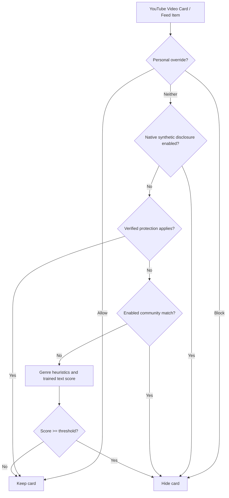

<div align="center">

# 🛡️ NoSlop — AI Video Blocker for YouTube

**Use local metadata, community matches, and statistical scoring to hide low-effort generated content.**

[](https://developer.chrome.com/docs/extensions/mv3/intro/)
[](#)
[](community-blocklist.json)
[](LICENSE)
[](https://github.com/pranav256/block-ai-slop/pulls)
[](#installation)

[Features](#key-features) • [Creator Safety](#creator-safety--zero-false-positives) • [How It Works](#how-the-engines-work) • [Installation](#installation) • [Chrome Web Store Submission](CHROME_STORE_SUBMISSION_GUIDE.md) • [Privacy Policy](PRIVACY.md) • [Contributing](#contributing)

</div>

---

## 🎯 Local Hybrid Detection

> **Important Distinction:** Real human creators (such as Neil deGrasse Tyson on *StarTalk*, Steven Bartlett on *The Diary Of A CEO*, or Lex Fridman) frequently interview AI pioneers (like Geoffrey Hinton) and use AI-generated robots or backgrounds in their thumbnails.

NoSlop combines native YouTube synthetic disclosures, exact community channel/video matches, generation hashtags and text, genre heuristics, and statistical text features. Verified channels receive automatic protection by default, except when a native synthetic disclosure is present. Personal block and allow entries take priority; an allow entry wins if both match.

Thumbnail analysis is disabled by default. The text model uses hashed character n-grams and style features, and abstains when training or positive-versus-negative evidence is insufficient. These are heuristic scores, not guaranteed proof of AI authorship. See [the algorithm dossier](AUDIT_DOSSIER.md) for validation and remaining work.

---

## ⚡ How the Engines Work



### Hybrid Scoring Engine *(Default ON)*
Native disclosures, generation text/hashtags, and specific genre co-occurrences provide heuristic signals. When those do not already reach sensitivity, the trained text model can contribute character similarity and style evidence. The largest signal score is compared with the selected threshold.

### Community Blocklist and Model Seeds
The community engine directly matches indexed channel names, handles, IDs, and video IDs. A bounded sample also seeds the text model. The list can be refreshed from GitHub; disabling community filtering leaves personal overrides active.

### Script Statistics
The script analyzer contributes generic repetition, lexical diversity, sentence rhythm, and punctuation features. It contains no phrase dictionary.

---

## 🚀 Installation (Takes 15 Seconds)

Works on any Chromium browser: **Google Chrome**, **Brave**, **Microsoft Edge**, **Opera**, or **Arc**.

1. **Clone or Download** this repository:
   ```bash
   git clone https://github.com/pranav256/block-ai-slop.git
   ```
   *(Or download the repository as a ZIP and extract it to `d:\block-ai-slop`)*
2. Open your browser and navigate to `chrome://extensions/` (or `brave://extensions/`).
3. Turn **ON** the **Developer mode** toggle in the top-right corner.
4. Click **Load unpacked** in the top-left corner.
5. Select the folder:
   ```
   d:\block-ai-slop
   ```
6. Pin **NoSlop** to your browser toolbar and enjoy a clean, slop-free YouTube experience!

---

## 🤝 Crowdsource Reporting & Training Data

Encountered a new AI video or channel that slipped through? **Block it without a second thought:**

1. **Hover over any video card on YouTube** to reveal the quick action bar:
   * **`[Block Channel]`**: Adds an explicit personal channel override and hides it.
   * **`[Report Slop]`**: Instantly blocks it locally, saves the channel/video details in a local report queue, and opens a pre-filled [GitHub Issue Report](https://github.com/pranav256/block-ai-slop/issues/new?template=report-slop.yml).
2. Use **Export JSON** in the popup to download the local report queue as a JSON file. The extension does not upload the queue automatically.
3. Submitted reports can be reviewed for community entries and model-training data.
4. Community data syncs automatically for users who enable it.

---

## 🎛️ Extension Settings & Popup

* **Sensitivity Selector**:
   * **Low (Conservative)**: Threshold = `0.65` (requires a higher statistical score)
   * **Balanced (Default)**: Threshold = `0.50`
   * **High (Aggressive)**: Threshold = `0.35` (lower evidence requirement)
* **Placeholder Mode**:
  * **Off (Default / AdBlock Style)**: Videos completely vanish from the page (`display: none !important;`) with zero leftover whitespace.
  * **On**: Shows a minimal, collapsible hairline bar (*"AI video hidden — Click to view"*).
* **Sync Now Button**: Manually refreshes community data from GitHub.
* **Allowlist**: Trusted channels can be exempted by name or handle from the popup's channel controls.

---

## 📁 Repository Structure

```
block-ai-slop/
├── manifest.json                       # Manifest V3 extension configuration
├── community-blocklist.json            # Community matches and bounded model seeds
├── .github/
│   └── ISSUE_TEMPLATE/
│       └── report-slop.yml             # Structured crowdsource slop reporting form
├── background/
│   └── background.js                   # Service worker & GitHub community-data sync
├── content/
│   ├── content.js                      # Core DOM orchestrator & hover actions
│   ├── content.css                     # Zero-gap hiding rules & unslop UI
│   └── engines/
│       ├── scoringEngine.js            # Engine 1: Heuristic and trained text scoring
│       ├── semanticEngine.js           # Hashed character n-gram classifier
│       ├── thumbnailEngine.js          # Engine 2: Canvas vision texture analyzer (Optional)
│       ├── communityEngine.js          # Personal overrides and exact community indexes
│       └── audioScriptEngine.js        # Engine 4: Generic script pattern analysis
├── popup/
│   ├── popup.html                      # Unslop control panel
│   ├── popup.css                       # Graphite design & hairline borders
│   └── popup.js                        # Settings & rule management
├── scripts/
│   ├── update-community-blocklist.js   # Automated training-corpus aggregator
│   ├── generate-cws-assets.js          # Generator for store promotional graphics & screenshots
│   └── build-extension-zip.js          # Automated CWS release packaging script
├── store_assets/                       # 1280x800 screenshots and 920x680/440x280 promo tiles
├── dist/                               # Production ZIP archive ready for CWS upload
├── icons/                              # 16px, 48px, 128px PNGs & SVG
├── PRIVACY.md                          # Chrome Web Store compliant privacy policy
├── CWS_STORE_LISTING.md                # Pre-formatted store copy & permission justifications
├── CHROME_STORE_SUBMISSION_GUIDE.md    # Step-by-step developer console submission walkthrough
└── README.md
```

---

## 🛠️ Contributing

Contributions are warmly welcomed!
* Improve model quality by contributing representative labeled training data to [`community-blocklist.json`](community-blocklist.json).
* Open an issue using the [Report AI Slop Template](https://github.com/pranav256/block-ai-slop/issues/new?template=report-slop.yml).

---

## 📄 License

This project is open-source and licensed under the [MIT License](LICENSE).
