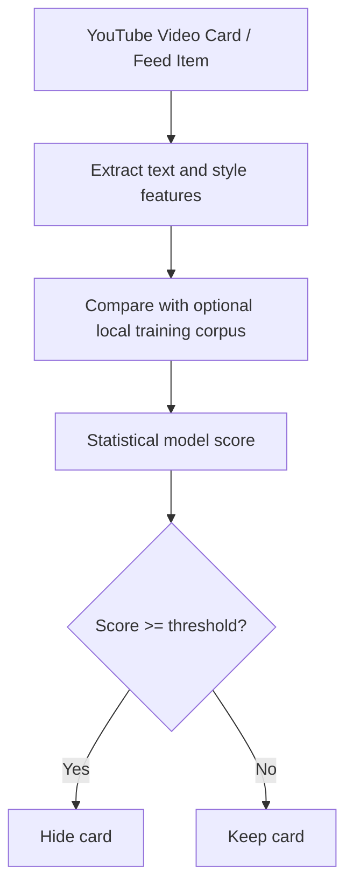

<div align="center">

# 🛡️ NoSlop — AI Video Blocker for YouTube

**Use local statistical scoring to identify low-effort generated content without hard-coded topic or channel rules.**

[](https://developer.chrome.com/docs/extensions/mv3/intro/)
[](#)
[](community-blocklist.json)
[](LICENSE)
[](https://github.com/pranav256/block-ai-slop/pulls)
[](#installation)

[Features](#key-features) • [Creator Safety](#creator-safety--zero-false-positives) • [How It Works](#how-the-engines-work) • [Installation](#installation) • [Chrome Web Store Submission](CHROME_STORE_SUBMISSION_GUIDE.md) • [Privacy Policy](PRIVACY.md) • [Contributing](#contributing)

</div>

---

## 🎯 Algorithm-Only Automatic Blocking

> **Important Distinction:** Real human creators (such as Neil deGrasse Tyson on *StarTalk*, Steven Bartlett on *The Diary Of A CEO*, or Lex Fridman) frequently interview AI pioneers (like Geoffrey Hinton) and use AI-generated robots or backgrounds in their thumbnails.

NoSlop makes automatic decisions from local statistical features only. It does not directly block channel names, keywords, hashtags, disclosure phrases, story formulas, or verified creators. Explicit user block and allow entries remain available as personal overrides.

Thumbnail analysis is disabled by default. Text is represented with hashed character n-grams and language-neutral style features, then evaluated using similarity, lexical diversity, repetition, entropy, punctuation, and title/description overlap.

---

## ⚡ How the Engines Work



### Statistical Scoring Engine *(Primary / Default ON)*
The model combines hashed character n-gram similarity with lexical diversity, repetition, entropy, punctuation, and title/description overlap. The final score is compared with the selected sensitivity threshold.

### Optional Training Corpus
The bundled community data is labeled positive training input for the model. It is never used as a direct channel, handle, or video blocking rule and can be refreshed from GitHub.

### Script Statistics
The script analyzer contributes generic repetition, lexical diversity, sentence rhythm, and punctuation features. It contains no phrase dictionary.

---

## 🚀 Installation (Takes 15 Seconds)

Works on any Chromium browser: **Google Chrome**, **Brave**, **Microsoft Edge**, **Opera**, or **Arc**.

1. **Clone or Download** this repository:
   ```bash
   git clone https://github.com/pranav256/block-ai-slop.git
   ```
   *(Or download the repository as a ZIP and extract it to `d:\block-ai-slop`)*
2. Open your browser and navigate to `chrome://extensions/` (or `brave://extensions/`).
3. Turn **ON** the **Developer mode** toggle in the top-right corner.
4. Click **Load unpacked** in the top-left corner.
5. Select the folder:
   ```
   d:\block-ai-slop
   ```
6. Pin **NoSlop** to your browser toolbar and enjoy a clean, slop-free YouTube experience!

---

## 🤝 Crowdsource Reporting & Training Data

Encountered a new AI video or channel that slipped through? **Block it without a second thought:**

1. **Hover over any video card on YouTube** to reveal the quick action bar:
   * **`[Block Channel]`**: Adds an explicit personal channel override and hides it.
   * **`[Report Slop]`**: Instantly blocks it locally, saves the channel/video details in a local report queue, and opens a pre-filled [GitHub Issue Report](https://github.com/pranav256/block-ai-slop/issues/new?template=report-slop.yml).
2. Use **Export JSON** in the popup to download the local report queue as a JSON file. The extension does not upload the queue automatically.
3. Submitted reports can be reviewed as new labeled model-training data.
4. Training data syncs automatically for users who enable it.

---

## 🎛️ Extension Settings & Popup

* **Sensitivity Selector**:
   * **Low (Conservative)**: Threshold = `0.65` (requires a higher statistical score)
  * **Balanced (Default)**: Threshold = `0.50` (Recommended balance, blocks melodrama tropes and disclaimers)
  * **High (Aggressive)**: Threshold = `0.35` (Aggressively purges anything resembling automated content)
* **Placeholder Mode**:
  * **Off (Default / AdBlock Style)**: Videos completely vanish from the page (`display: none !important;`) with zero leftover whitespace.
  * **On**: Shows a minimal, collapsible hairline bar (*"AI video hidden — Click to view"*).
* **Sync Now Button**: Manually refreshes the optional model-training corpus from GitHub.
* **Allowlist**: Trusted channels can be exempted by name or handle from the popup's channel controls.

---

## 📁 Repository Structure

```
block-ai-slop/
├── manifest.json                       # Manifest V3 extension configuration
├── community-blocklist.json            # Optional statistical training corpus
├── .github/
│   └── ISSUE_TEMPLATE/
│       └── report-slop.yml             # Structured crowdsource slop reporting form
├── background/
│   └── background.js                   # Service worker & GitHub training-data sync
├── content/
│   ├── content.js                      # Core DOM orchestrator & hover actions
│   ├── content.css                     # Zero-gap hiding rules & unslop UI
│   └── engines/
│       ├── scoringEngine.js            # Engine 1: Multi-signal Bayesian heuristic
│       ├── thumbnailEngine.js          # Engine 2: Canvas vision texture analyzer (Optional)
│       ├── communityEngine.js          # User overrides and training data loader
│       └── audioScriptEngine.js        # Engine 4: Generic script pattern analysis
├── popup/
│   ├── popup.html                      # Unslop control panel
│   ├── popup.css                       # Graphite design & hairline borders
│   └── popup.js                        # Settings & rule management
├── scripts/
│   ├── update-community-blocklist.js   # Automated training-corpus aggregator
│   ├── generate-cws-assets.js          # Generator for store promotional graphics & screenshots
│   └── build-extension-zip.js          # Automated CWS release packaging script
├── store_assets/                       # 1280x800 screenshots and 920x680/440x280 promo tiles
├── dist/                               # Production ZIP archive ready for CWS upload
├── icons/                              # 16px, 48px, 128px PNGs & SVG
├── PRIVACY.md                          # Chrome Web Store compliant privacy policy
├── CWS_STORE_LISTING.md                # Pre-formatted store copy & permission justifications
├── CHROME_STORE_SUBMISSION_GUIDE.md    # Step-by-step developer console submission walkthrough
└── README.md
```

---

## 🛠️ Contributing

Contributions are warmly welcomed!
* Improve model quality by contributing representative labeled training data to [`community-blocklist.json`](community-blocklist.json).
* Open an issue using the [Report AI Slop Template](https://github.com/pranav256/block-ai-slop/issues/new?template=report-slop.yml).

---

## 📄 License

This project is open-source and licensed under the [MIT License](LICENSE).
