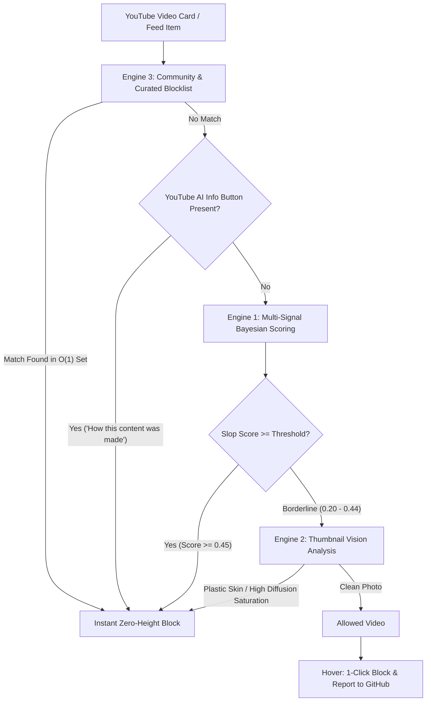

<div align="center">

# 🛡️ NoSlop — AI Video Blocker for YouTube

**Eliminate AI-generated slop, synthetic media disclosures, and automated drama mills from YouTube feeds just like AdBlock.**

[](https://developer.chrome.com/docs/extensions/mv3/intro/)
[](#)
[](LICENSE)
[](https://github.com/pranav256/block-ai-slop/pulls)
[](#installation)

[Features](#key-features) • [How It Works](#how-the-4-engines-work) • [Installation](#installation-takes-15-seconds) • [Crowdsource Reporting](#crowdsource-reporting--community-sync) • [Contributing](#contributing)

</div>

---

## 💡 Why Simple Keyword Blockers Fail

Automated AI channels have evolved. Modern content mills deliberately game YouTube's algorithm:
1. **They don't use the word "AI"** in titles (opting for formulaic melodrama tropes like *"She Called Security on Her Ex... Then the Chairman Arrived"*).
2. **They evade spelling filters** using homoglyphs or lookalikes (e.g. `Hero Al Dramas` with a lowercase `l` instead of `AI`).
3. **They dodge YouTube's disclosure** by refusing to check the *"Altered or synthetic content"* box during upload.

**NoSlop** solves this by combining **4 complementary detection engines** operating simultaneously with zero perceptible latency.

---

## ⚡ How the 4 Engines Work



### 1. Multi-Signal Bayesian Scoring Engine *(Primary / Default ON)*
Accumulates independent probability signals ($P \in [0.0, 1.0]$) to catch sneaky videos without false positives:
* **YouTube Official AI Info Button**: Catches native *"How this content was made"*, *"Altered or synthetic"*, and *"Made with AI"* labels (Weight: `1.0`).
* **Greedy AI Hashtags**: Matches `/#ai[a-z0-9_-]*/i` (`#AIStory`, `#AIDrama`, `#AIFilm`) even when jammed after punctuation (`BOSS!#AIStory`).
* **Automated Script Disclaimers**: Detects boilerplate injected by script generators (*"complies with EDSA standards"*, *"not a real-life scenario"*).
* **Melodrama Plot Formulas**: Flags automated content tropes (*"She called security on her ex... then the chairman"*, *"He made his wife a billionaire"*, *"Useless son-in-law is the Dragon King"*).
* **Homoglyph Normalization**: Normalizes character replacements (e.g. `Hero Al` with lowercase `l` $\rightarrow$ `Hero AI`).

### 2. Thumbnail Vision & Texture Analyzer
* Samples video thumbnails into an in-memory 48×48 `<canvas>` without taxing your GPU.
* Analyzes pixel distributions for the **Midjourney / Stable Diffusion aesthetic**: hyper-saturated facial skin tones paired with abnormally low pore/texture gradient variance ("plastic skin").

### 3. Community & Curated Consensus Engine
* Pre-seeded $O(1)$ Hash Set of known automated drama mills (`Nov Drama`, `Hero AI Dramas`, `Tale Time66`, `DramaBox`, `ShortMax`, `ReelShort`, etc.).
* **GitHub Sync**: Automatically syncs newly reported channels from the centralized [`community-blocklist.json`](community-blocklist.json) file every 6 hours.

### 4. Watch Page Audio & Script Cadence Analyzer
* **Script Perplexity**: Scans video descriptions and transcripts for repetitive LLM n-grams (*"delve into"*, *"testament to"*, *"in a world where"*, *"little did he know"*).
* **TTS Voiceover Monitor**: Uses the Web Audio API to detect robotic narration cadence (unvarying 50–100ms micro-pauses with missing natural breath cycles).

---

## 🚀 Installation (Takes 15 Seconds)

Works on any Chromium browser: **Google Chrome**, **Brave**, **Microsoft Edge**, **Opera**, or **Arc**.

1. **Clone or Download** this repository:
   ```bash
   git clone https://github.com/pranav256/block-ai-slop.git
   ```
   *(Or download the repository as a ZIP and extract it to `d:\block-ai-slop`)*
2. Open your browser and navigate to `chrome://extensions/` (or `brave://extensions/`).
3. Turn **ON** the **Developer mode** toggle in the top-right corner.
4. Click **Load unpacked** in the top-left corner.
5. Select the folder:
   ```
   d:\block-ai-slop
   ```
6. Pin **NoSlop** to your browser toolbar and enjoy a clean, slop-free YouTube experience!

---

## 🤝 Crowdsource Reporting & Community Sync

Encountered a new AI video or channel that slipped through? **Block it without a second thought:**

1. **Hover over any video card on YouTube** to reveal the quick action bar:
   * **`[Block Channel]`**: Instantly adds the channel to your local blacklist and permanently hides it.
   * **`[Report Slop]`**: Instantly blocks it locally AND opens a pre-filled [GitHub Issue Report](https://github.com/pranav256/block-ai-slop/issues/new?template=report-slop.yml) with the channel name and video title.
2. Once submitted, community reports are merged into [`community-blocklist.json`](community-blocklist.json).
3. **All users** of the extension automatically receive the updated blocklist via background sync!

---

## 🎛️ Extension Settings & Popup

* **Sensitivity Selector**:
  * **Low (Conservative)**: Threshold = `0.65` (Only blocks explicit AI disclosures and direct keywords)
  * **Balanced (Default)**: Threshold = `0.45` (Recommended balance, blocks melodrama tropes and disclaimers)
  * **High (Aggressive)**: Threshold = `0.35` (Aggressively purges anything resembling automated content)
* **Placeholder Mode**:
  * **Off (Default / AdBlock Style)**: Videos completely vanish from the page (`display: none !important;`) with zero leftover whitespace.
  * **On**: Shows a minimal, collapsible hairline bar (*"AI video hidden — Click to view"*).
* **Sync Now Button**: Manually forces an instant fetch of the latest community blocklist from GitHub.

---

## 📁 Repository Structure

```
block-ai-slop/
├── manifest.json                       # Manifest V3 extension configuration
├── community-blocklist.json            # Centralized community-curated blocklist
├── .github/
│   └── ISSUE_TEMPLATE/
│       └── report-slop.yml             # Structured crowdsource slop reporting form
├── background/
│   └── background.js                   # Service worker & GitHub community auto-sync
├── content/
│   ├── content.js                      # Core DOM orchestrator & hover actions
│   ├── content.css                     # Zero-gap hiding rules & unslop UI
│   └── engines/
│       ├── scoringEngine.js            # Engine 1: Multi-signal Bayesian heuristic
│       ├── thumbnailEngine.js          # Engine 2: Canvas vision texture analyzer
│       ├── communityEngine.js          # Engine 3: O(1) Hash Set & homoglyphs
│       └── audioScriptEngine.js        # Engine 4: LLM perplexity & TTS cadence
├── popup/
│   ├── popup.html                      # Unslop control panel
│   ├── popup.css                       # Graphite design & hairline borders
│   └── popup.js                        # Settings & rule management
├── icons/                              # 16px, 48px, 128px PNGs & SVG
└── README.md
```

---

## 🛠️ Contributing

Contributions are warmly welcomed!
* Found new AI story formulas or automated channels? Submit a PR adding them to [`community-blocklist.json`](community-blocklist.json) or [`content/engines/scoringEngine.js`](content/engines/scoringEngine.js).
* Open an issue using the [Report AI Slop Template](https://github.com/pranav256/block-ai-slop/issues/new?template=report-slop.yml).

---

## 📄 License

This project is open-source and licensed under the [MIT License](LICENSE).
