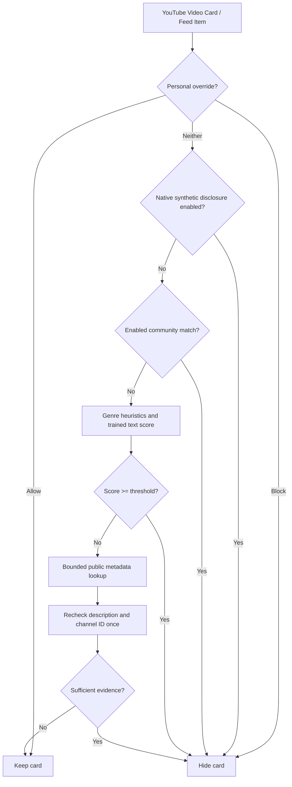

<div align="center">

# 🛡️ NoSlop — AI Video Blocker for YouTube

**Use local metadata, community matches, and statistical scoring to hide low-effort generated content.**

[](https://developer.chrome.com/docs/extensions/mv3/intro/)
[](#)
[](community-blocklist.json)
[](LICENSE)
[](https://github.com/pranav256/block-ai-slop/pulls)
[](#installation)

[Features](#key-features) • [Creator Safety](#creator-safety--zero-false-positives) • [How It Works](#how-the-engines-work) • [Installation](#installation) • [Chrome Web Store Submission](CHROME_STORE_SUBMISSION_GUIDE.md) • [Privacy Policy](PRIVACY.md) • [Contributing](#contributing)

</div>

---

## 🎯 Local Hybrid Detection

> **Important Distinction:** Real human creators (such as Neil deGrasse Tyson on *StarTalk*, Steven Bartlett on *The Diary Of A CEO*, or Lex Fridman) frequently interview AI pioneers (like Geoffrey Hinton) and use AI-generated robots or backgrounds in their thumbnails.

NoSlop combines native YouTube synthetic disclosures, exact community channel/video matches, contextual generation disclosures, genre heuristics, and a local nearest-example text model. Verified channels receive protection from weak automatic signals, while explicit production disclosures and exact blocklist matches still apply. Personal allow entries take priority over matching block rules.

Thumbnail analysis is disabled by default. The text model uses hashed character n-grams, words, and word pairs with both slop and human examples, and abstains when positive-versus-negative evidence is insufficient. Undecided cards can be checked against public YouTube descriptions and channel IDs using bounded, cookie-free requests; classification stays local. These are heuristic scores, not proof of AI authorship or a 99% removal guarantee. See [the algorithm dossier](AUDIT_DOSSIER.md) for validation and limits.

---

## ⚡ How the Engines Work



### Hybrid Scoring Engine *(Default ON)*
Production disclosures, generation tools/hashtags, and specific genre co-occurrences provide signals. Context checks distinguish tutorials, investigations, and negated disclosures. Independent channel/provenance evidence can reinforce a text signal; correlated text formulas share one vote. The nearest-example model contributes only when similar human examples do not explain the wording better.

### Community Blocklist and Model Seeds
The community engine directly matches indexed channel names, handles, IDs, and video IDs. Encoded handles are decoded and channel IDs retain their case. The text model uses 125 handwritten video-text seeds rather than channel handles; local reports teach it additional examples that survive rule changes. The list can be refreshed from GitHub; disabling community filtering leaves personal overrides active.

### Script Statistics
The script analyzer measures repetition, lexical diversity, and sentence rhythm. Repetition requires supporting text evidence before it can block a card; ordinary repeated song lyrics are not proof of generated content.

### Public Metadata Lookup
Undecided cards can lack the description or channel ID needed for a reliable match. NoSlop retrieves only public watch-page metadata from YouTube, without account cookies, and never downloads the video/audio stream. Two requests can run at once with a bounded queue and temporary cache. Errors and rate limits fall back to local filtering. See [privacy details](PRIVACY.md).

### Checking the changes

Reload the unpacked extension from this repository in your browser's extensions page, then refresh existing YouTube tabs. Existing sensitivity choices are preserved; **High** applies the strongest filtering.

```powershell
Get-ChildItem scripts/test-*.js | ForEach-Object { node $_.FullName; if ($LASTEXITCODE) { throw $_.Name } }
node scripts/test-detector-quality.js --aggressive
node scripts/cdp-benchmark.js
node scripts/live-browser-test.js
node --expose-gc scripts/benchmark-performance.js
node scripts/build-extension-zip.js
```

The quality fixtures are handwritten regression cases, not a representative real-world accuracy benchmark. The Chromium fixture uses real DOM/observer behavior with mocked Chrome APIs and metadata responses. The live-browser test uses the native extension on real YouTube searches without mocks; it needs network access and exits with code 2 when YouTube is unavailable or presents a challenge. Set `NOSLOP_BROWSER` if Chromium is not at a standard installation path.

---

## 🚀 Installation (Takes 15 Seconds)

Works on any Chromium browser: **Google Chrome**, **Brave**, **Microsoft Edge**, **Opera**, or **Arc**.

1. **Clone or Download** this repository:
   ```bash
   git clone https://github.com/pranav256/block-ai-slop.git
   ```
   *(Or download the repository as a ZIP and extract it to `d:\block-ai-slop`)*
2. Open your browser and navigate to `chrome://extensions/` (or `brave://extensions/`).
3. Turn **ON** the **Developer mode** toggle in the top-right corner.
4. Click **Load unpacked** in the top-left corner.
5. Select the folder:
   ```
   d:\block-ai-slop
   ```
6. Pin **NoSlop** to your browser toolbar and enjoy a clean, slop-free YouTube experience!

---

## 🤝 Crowdsource Reporting & Training Data

Encountered a new AI video or channel that slipped through? **Block it without a second thought:**

1. **Hover over any video card on YouTube** to reveal the quick action bar:
   * **`[Block Channel]`**: Adds an explicit personal channel override and hides it.
   * **`[Report Slop]`**: Instantly blocks it locally, saves the channel/video details in a local report queue, and opens a pre-filled [GitHub Issue Report](https://github.com/pranav256/block-ai-slop/issues/new?template=report-slop.yml).
2. Use **Export JSON** in the popup to download the local report queue as a JSON file. The extension does not upload the queue automatically.
3. Submitted reports can be reviewed for community entries and model-training data.
4. Community data syncs automatically for users who enable it.

---

## 🎛️ Extension Settings & Popup

* **Sensitivity Selector**:
   * **Low (Conservative)**: Threshold = `0.65` (requires a higher statistical score)
   * **Balanced (Default)**: Threshold = `0.50`
   * **High (Aggressive)**: Threshold = `0.35` (lower evidence requirement)
* **Placeholder Mode**:
  * **Off (Default / AdBlock Style)**: Videos completely vanish from the page (`display: none !important;`) with zero leftover whitespace.
  * **On**: Shows a minimal, collapsible hairline bar (*"AI video hidden — Click to view"*).
* **Sync Now Button**: Manually refreshes community data from GitHub.
* **Allowlist**: Trusted channels can be exempted by name or handle from the popup's channel controls.

---

## 📁 Repository Structure

```
block-ai-slop/
├── manifest.json                       # Manifest V3 extension configuration
├── community-blocklist.json            # Community matches and bounded model seeds
├── .github/
│   └── ISSUE_TEMPLATE/
│       └── report-slop.yml             # Structured crowdsource slop reporting form
├── background/
│   └── background.js                   # Service worker & GitHub community-data sync
├── content/
│   ├── content.js                      # Core DOM orchestrator & hover actions
│   ├── content.css                     # Zero-gap hiding rules & unslop UI
│   └── engines/
│       ├── scoringEngine.js            # Engine 1: Heuristic and trained text scoring
│       ├── semanticEngine.js           # Bounded nearest-example video-text classifier
│       ├── thumbnailEngine.js          # Engine 2: Canvas vision texture analyzer (Optional)
│       ├── communityEngine.js          # Personal overrides and exact community indexes
│       └── audioScriptEngine.js        # Engine 4: Generic script pattern analysis
├── popup/
│   ├── popup.html                      # Unslop control panel
│   ├── popup.css                       # Graphite design & hairline borders
│   └── popup.js                        # Settings & rule management
├── scripts/
│   ├── update-community-blocklist.js   # Automated training-corpus aggregator
│   ├── generate-cws-assets.js          # Generator for store promotional graphics & screenshots
│   └── build-extension-zip.js          # Automated CWS release packaging script
├── store_assets/                       # 1280x800 screenshots and 920x680/440x280 promo tiles
├── dist/                               # Production ZIP archive ready for CWS upload
├── icons/                              # 16px, 48px, 128px PNGs & SVG
├── PRIVACY.md                          # Chrome Web Store compliant privacy policy
├── CWS_STORE_LISTING.md                # Pre-formatted store copy & permission justifications
├── CHROME_STORE_SUBMISSION_GUIDE.md    # Step-by-step developer console submission walkthrough
└── README.md
```

---

## 🛠️ Contributing

Contributions are warmly welcomed!
* Contribute reviewed channel identities to [`community-blocklist.json`](community-blocklist.json), and video-text training examples to `content/engines/trainingData.js`. Keep evaluation cases separate from training.
* Open an issue using the [Report AI Slop Template](https://github.com/pranav256/block-ai-slop/issues/new?template=report-slop.yml).

---

## 📄 License

This project is open-source and licensed under the [MIT License](LICENSE).
